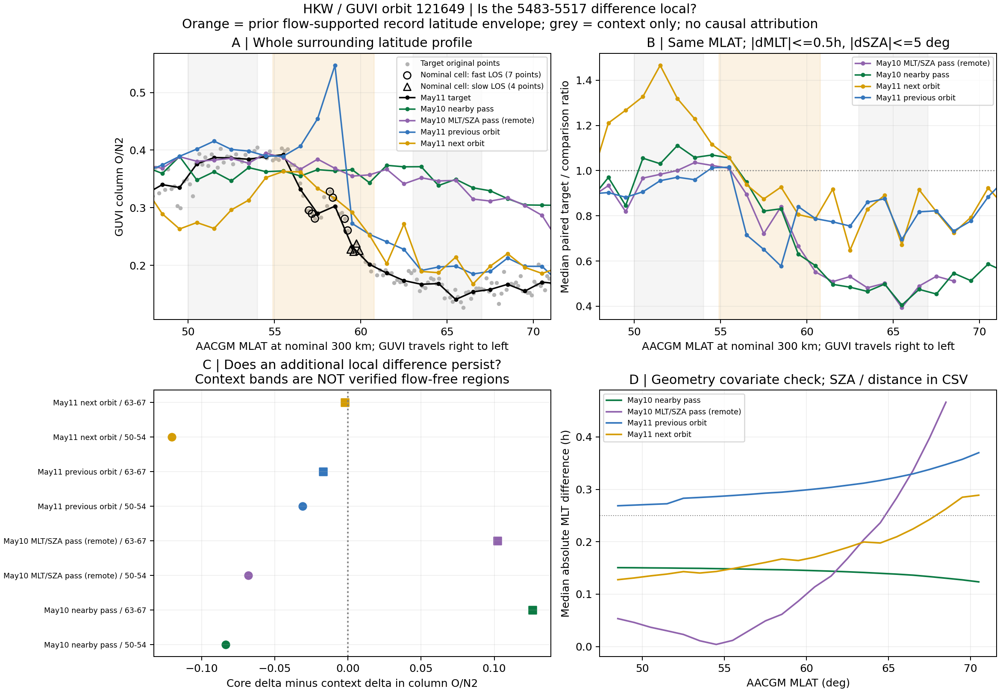
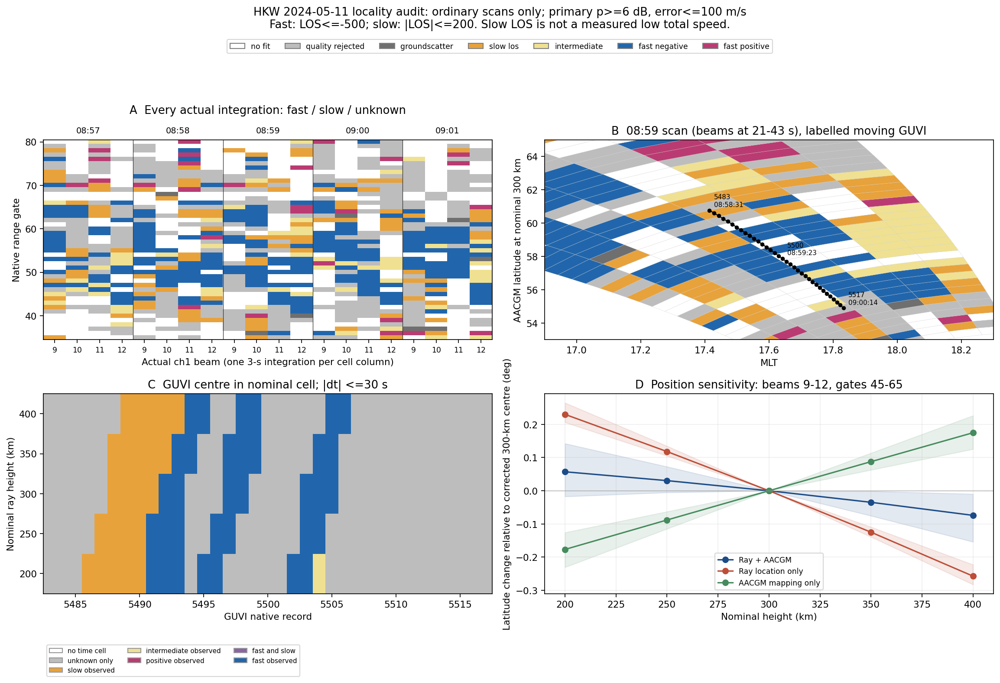

# SAPS 与柱 O/N₂ 联合观测进展

更新日期：2026-10-15。本文属于观测工作，不包含 TIEGCM–TREx 或 SAMI3–TIEGCM 模型结果。与[统计与筛选线](SAPS_ON2_STATISTICAL_PROGRESS_20261015.md)分开阅读；[总入口](SAPS_ON2_RESEARCH_HANDOFF_20261015.md)给出当前决策问题。

## 当前结论

已经找到可复查的增强流与 GUVI 柱 O/N₂ 联合观测候选，但尚未获得“局地 SAPS 导致成分变化”的观测结论。当前优先分析 2024-05-11 约 08:58–09:00 UTC 的 HKW 候选，重点判断局地成分差异能否与磁暴区域背景区分。

10月15日新增的成分比较表明：固定近流带采样段的柱 O/N₂ 相对前一天近地理参照偏低，但低值继续向更高磁纬延伸，同日相邻轨也存在高纬低值。它削弱了“核心低值本身就证明局地 SAPS 效应”的解释；尚不能据此证明差异完全由区域背景造成，也不能排除局地贡献。

**10月15日专项报告的判定：现有覆盖与不确定性无法区分。** 雷达精确格点核查、成分背景敏感性及独立复核均已落盘。专项建议暂缓把本例作为局地SAPS耗损或机制主个例，保留为区域成分变化下的协同观测候选。本次交接记录这一有界结论，不将它推广为所有SAPS均无成分效应。

## 研究设计如何收缩

原设计是三个可比联合观测个例，再选择一例中性风和温度观测最完整的事件深入解释机制。三个穿越若来自同一磁暴，不能当成三个独立磁暴。

现阶段先不扩展第三例或年度统计，也不以补齐所有中性观测为前置目标。先回答：

> HKW 这次增强流附近的柱 O/N₂ 偏低，是否存在区别于周围磁暴区域背景的局地结构？现有采样足以区分吗？

流场先定义候选和采样范围，再读取成分；O/N₂ 升降不参与事件选择。SAPS 分类、成分异常、二者关联及因果解释分别判断。

## 2024年5月筛选实际完成了什么

分析窗口为 2024-05-10 00:00 至 05-14 00:00 UTC。现有报告记录：

| 单位 | 已完成范围 | 不代表什么 |
|---|---:|---|
| GUVI 原生轨段 | 213段，其中30–75° AACGM机会120段 | 不是120个独立事件 |
| 本地雷达批筛 | 26个相关台站，1,226组名义配对，1,156组有实际时次记录 | 有记录不等于有有效回波 |
| 近门覆盖 | 88个轨段有实际雷达窗口，82个至少有诊断合格近门 | 不等于完整足迹或流道穿越 |
| 成分和流场细查 | 6轨完成成分描述，5窗口完成详细流场审阅 | 其余未审阅不是无SAPS |
| 优先候选 | 5月11日 JME/LJE 与 HKW 两次穿越 | 不是两次独立磁暴或已确证SAPS |

5月13日全网雷达资料未齐，有限单站补查不等于完成全网。此前报告中的27项测试通过支持数据处理与特定回归修复，不替代事件分类或科学结论。

## 候选之间的区别

| 候选 | 已有支持 | 柱 O/N₂ 描述 | 关键限制与用途 |
|---|---|---|---|
| 2024-05-11 07:22 UTC，JME/LJE | 双站多束、西向相容的增强流 | 固定流段中位0.411，前期参照0.329，方向偏高 | 参照雷达无诊断质量门，不能称无流控制；保留相反方向比较，不作独立磁暴样本 |
| 2024-05-11 08:58–09:00 UTC，HKW | 普通扫描通道内持续多束强负LOS；原始近门诊断可复查 | 低纬5483–5517段中位约0.295，旧端点参照约0.363 | 当前重点；流道边缘、足迹、沉降边界和局地背景均需独立约束 |
| 2024-08-12约09:40 UTC，G02 | HKW持续多束流与F16可靠强横轨漂移相互支持 | 原生GUVI沿轨变化存在 | 局地6个GUVI中心重复对应一次雷达积分；无有效同期当地SSUSI边界，未建立稳定流道内外异常 |

HKW 10月14日近门参照检查中，低纬段事件/前期参照分别有91/49个诊断质量门样本，LOS中位约−771.6/−13.7 m/s。这些包含重复观测，不是独立样本显著性；近门样本也不能自动升级为精确格点相交。完整小表见[邻日雷达参照](../data_samples/research_handoff_20261015/hkw_reference_radar_audit.csv)。

## HKW 10月15日区域背景检查

目标为 GUVI orbit121649 的原生记录5483–5517，35点，54.890–60.764°磁纬；这只是此前由流场确定的近邻采样包络，不能把35点整体称为已验证的“通道内”。

综合专项采用固定沿轨参照：低纬50–54°、22点，以及高纬63–67°、26点。三个纬段不能直接称为流道内外。早期独立成分检查还使用过62–66°、25点的高纬带，其比值0.473属于另一口径，不与这里63–67°的0.458混用。四条参考轨按几何选择，不按O/N₂方向取舍。

| 目标纬段 | 参照 | 目标/参照中位数 | 中位数之比 | 几何含义 |
|---|---|---|---:|---|
| 5483–5517近流段 | 前日近地理121634 | 0.29523 / 0.36391 | 0.8113 | 中位地距268 km；并非同一空气柱 |
| 同一近流段 | 前日MLT/SZA相近121637 | 0.29523 / 0.37179 | 0.7941 | 中位地距3394 km；只能作几何敏感性参照 |
| 同一近流段 | 同日前一轨121648 | 0.29523 / 0.37619 | 0.7848 | 相差约1.61 h、1227 km；区域参照 |
| 同一近流段 | 同日后一轨121650 | 0.29523 / 0.33127 | 0.8912 | 相差约1.61 h、1237 km；区域参照 |
| 低纬50–54° | 前日近地理121634 | 0.38444 / 0.35390 | 1.0863 | 沿轨低纬梯度，未证实为无流区 |
| 高纬63–67° | 前日近地理121634 | 0.15875 / 0.34695 | 0.4575 | 更明显低值继续向高纬延伸，未证实为流道外 |

汇总见[标准配置12组成分比较](../data_samples/research_handoff_20261015/hkw_on2_standard_comparisons.csv)。它从综合专项`band_sensitivity.csv`机械选取四参考、三个固定纬段的`standard`行，保留原列和值。表中比值是两组匹配点中位数之比，不是逐点比值的中位数；0.8113与此前约0.813的差别来自稍不同的端点/配对口径，不应当成物理变化。

标准匹配在统一300 km坐标口径下，先取最近磁纬参考点，再检验磁纬差不超过0.25°、MLT差不超过0.5 h、SZA差不超过5°；这不是穷举所有符合条件的参考点。因此严格配置的零配对不能推广为绝无其他可配点。300 km是坐标约定，不是说GUVI观测的是300 km局地密度比。前日近地理轨属于此次主冲击前参照，不自动等同于严格静稳背景。

图中橙色是此前近流带采样包络，灰色是沿轨周围区域，均未验证为流道内外。B面板使用逐点配对比值的中位数，与正文表格的两组中位数之比不同。相邻轨不是同一位置的时间序列。

### 雷达格点归属进一步收紧了结论

专项重新检查08:57–09:02 UTC的80次实际积分、5扫和4,507个原生拟合门，改用名义四边形包含关系及实际同束积分起始时刻差不超过30秒。35个GUVI中心在名义300 km主质量层下分为：

| 状态 | GUVI中心数 | 独立支持的含义 |
|---|---:|---|
| 合格强负LOS | 7 | 对应4个原生门、3次积分，不是7次独立确认 |
| 实测慢LOS | 4 | 对应同一次积分的2个门，不等于无流或低水平总速度 |
| 未知 | 24 | 17点无拟合、7点质量失败，不记为零速度 |

名义高度200–400 km时，仅6–7点得到强负LOS支持。旧近门方法支持的是附近存在多束流动，不能据此认定全部35点穿过流道。专项还修正了旧pyDARN调用中沿程中心参数未传递造成的半门定位约定问题；不将这一修正等同于解决真实HF传播或多跳误差。

图B保留各束真实时刻和移动GUVI轨迹，不是同一时刻的完整流场。相邻快慢门与中间缺测交错，未围出可靠的两侧边缘。另有18组HKW/JME区域交叉视线候选，但共同散射体积未确认，不能直接补成35点的流道归属。完整小表见[格点覆盖敏感性](../data_samples/research_handoff_20261015/hkw_focus_membership_summary.csv)。

### 扣除哪一侧背景会改变局地残差

定义诊断残差为：核心目标/参考配对差值的中位数，减去某周围纬带目标/参考配对差值的中位数。它不是已分离的SAPS效应量。

| 参考 | 扣赤道侧50–54°背景 | 扣极侧63–67°背景 |
|---|---:|---:|
| 前日近地理轨 | −0.0836 | +0.1262 |
| 前日MLT/SZA远地轨 | −0.0681 | +0.1022 |
| 同日前一轨 | −0.0310 | −0.0169 |
| 同日后一轨 | −0.1204 | −0.0021 |

更换背景侧或参考轨改变符号和幅度，且周围纬带未经独立证明为无流。数据来源见[背景残差](../data_samples/research_handoff_20261015/hkw_context_residual_standard.csv)。这正是局地附加作用尚不可识别的核心证据，而不是数值计算未完成。

### 数据目前支持的解释边界

- 相对前日前期轨，近流段柱比偏低的描述性差异仍在。
- 低值跨越该采样包络的高纬端继续延伸，同日相邻轨也呈现高纬低值，宽区域扰动和纬向梯度是实际存在的竞争解释。
- 相邻轨约1.61小时及约千公里的偏移，不能作为同地同时背景；也不能从这些比较中精确扣除一个“磁暴背景”并认定剩余量就是SAPS效应。
- GUVI本批L3没有逐点QC、误差及真实检索足迹，有限数值不等于异常已获独立验证；雷达也有定位、传播和LOS投影的不确定性。
- 当前应表述为“局地独有性未确立，区域背景解释不能排除”，而不是“SAPS没有影响”或“区域背景已经完全解释”。

## G02与中性观测的可复用边界

G02中，HKW在09:35–09:45 UTC有295个诊断强负LOS门样本、10次扫描，中位约−1335.7 m/s；F16有72个符合附加误差条件的高漂移点。两者支持区域增强流，但完整西向速度矢量、当地沉降边界及GUVI所采流道仍不完整。

GUVI时窗99个原生点的柱比中位约0.2154；其中6个与强LOS名义对应的中心复用一次积分，不能称六次独立确认。现有GOLD扫描不覆盖同一区域，不能提供此例成分参照；已取得的SABER温度切点距目标约两千公里，不是局地温度。上述缺口不能由“相同日期或同一卫星轨道”补齐。

5月11日两优先核心仍在日照区，已核实的FPI没有覆盖同区，尚无可支撑局地上涌/环流解释的完整风温组合。缺风温不使已有现象资料失效，但限制了机制结论。

## 当前决定与可继续的最小步骤

1. 暂缓把HKW提升为局地SAPS耗损或机制主个例，保留区域增强流、产品成分差异及不可判定证据。
2. 若继续补充，应优先获得同刻同扇区、覆盖实测流带与两侧的成分采样，并能独立核实流带边缘、足迹和SAPS分类；只增加风温或模型不能直接解决现有对照缺口。
3. 既有18组HKW/JME区域交叉视线值得低成本核查共同散射体积，但它们本身不提供同时流道外成分对照。
4. 若关键成分/足迹与边缘资料没有实际获取路径，则暂存该例，不继续以扩大搜索或改变阈值寻找预设正结果。

## 来源定位

本报告使用以下既有分析产物。路径为研究工作区内相对路径，供追溯；它们并非全部已发布到此仓库。公开讨论所需核心数值已在正文和四个小型CSV中列出。

- `summaries/ssusi_superdarn_gold/storm_may2024_20261013/README.md`：5月批筛分母、两候选与限制。
- `summaries/ssusi_superdarn_gold/storm_may2024_20261013/three_case_design/README.md`：三例设计、共同参照与中性观测可行性。
- `summaries/ssusi_superdarn_gold/storm_may2024_20261013/three_case_design/reference_radar_audit.csv`：8行事件/参照/台站分组。
- `summaries/ssusi_superdarn_gold/hkw_locality_20261015/README.md`、`independent_check.md`、`band_sensitivity.csv`、`context_residual_sensitivity.csv`及`radar_audit/`：10月15日综合局地性专项，优先采用此口径。
- `summaries/ssusi_superdarn_gold/storm_may2024_20261013/hkw_locality_20261015/composition_audit/`：早期独立成分核对，62–66°高纬带与综合专项63–67°分开。
- `summaries/ssusi_superdarn_gold/joint_case_G02_20261009/README.md`：G02原生观测复核与各仪器的实际覆盖。

本轮交接仅整理与核对已有产物，不重新执行科学分析，不把聊天中的进行中说明视为已完成验收。
